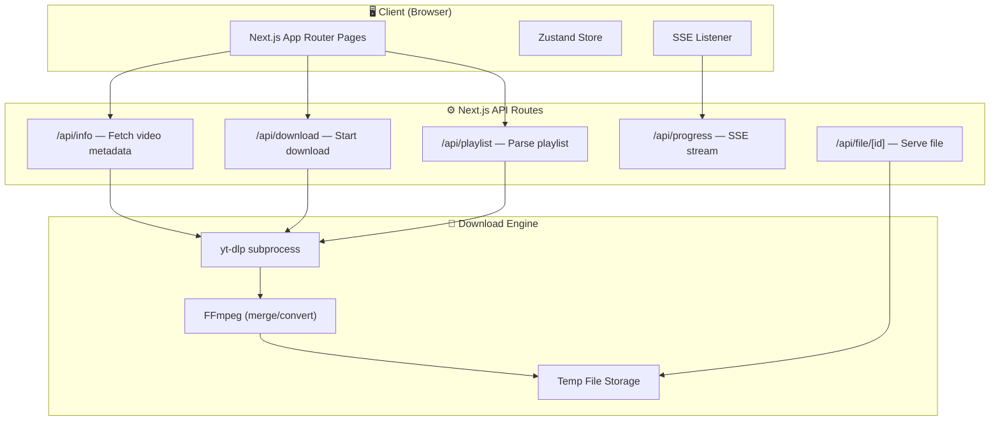
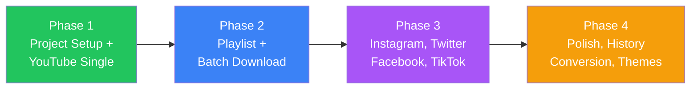

# 🎬 Universal Video Downloader — Detailed Project Plan

## Overview

A **Next.js 14+ (App Router)** full-stack web application that lets users download videos from **YouTube** (single, multiple, playlist), **Instagram Reels**, and other platforms. Modern, fast, beautiful UI with real-time download progress.

---

## Supported Platforms & Features

| Platform | Single Video | Multiple Videos | Playlist | Reels / Shorts |
|---|---|---|---|---|
| **YouTube** | ✅ | ✅ (batch URLs) | ✅ (full playlist) | ✅ (Shorts) |
| **Instagram** | ✅ (Post video) | ✅ | — | ✅ (Reels) |
| **Twitter / X** | ✅ | ✅ | — | — |
| **Facebook** | ✅ | ✅ | — | ✅ (Reels) |
| **TikTok** | ✅ | ✅ | — | — |

---

## Tech Stack

| Layer | Technology |
|---|---|
| **Framework** | Next.js 14+ (App Router, TypeScript) |
| **Styling** | Tailwind CSS 3 + shadcn/ui components |
| **State** | Zustand (lightweight global state) |
| **Backend / API** | Next.js Route Handlers (`app/api/`) |
| **Video Engine** | `yt-dlp` (Python CLI — most reliable) via child process |
| **Queue / Jobs** | BullMQ + Redis (optional, for heavy loads) |
| **Real-time** | Server-Sent Events (SSE) for download progress |
| **Validation** | Zod schemas |
| **Icons** | Lucide React |
| **Animations** | Framer Motion |

> [!IMPORTANT]
> `yt-dlp` is the most reliable cross-platform video extraction tool. It supports 1000+ sites out of the box. It must be installed on the server/machine.

---

## Architecture Diagram



---

## Directory Structure

```
video-downloader/
├── app/
│   ├── layout.tsx                  # Root layout (fonts, theme, metadata)
│   ├── page.tsx                    # Home / Landing page
│   ├── globals.css                 # Tailwind globals
│   │
│   ├── youtube/
│   │   ├── page.tsx                # YouTube downloader page
│   │   └── playlist/
│   │       └── page.tsx            # YouTube playlist downloader
│   │
│   ├── instagram/
│   │   └── page.tsx                # Instagram Reels downloader
│   │
│   ├── twitter/
│   │   └── page.tsx                # Twitter/X downloader
│   │
│   ├── facebook/
│   │   └── page.tsx                # Facebook downloader
│   │
│   ├── tiktok/
│   │   └── page.tsx                # TikTok downloader
│   │
│   └── api/
│       ├── info/
│       │   └── route.ts            # GET/POST — Fetch video metadata
│       ├── download/
│       │   └── route.ts            # POST — Start download job
│       ├── progress/
│       │   └── [jobId]/
│       │       └── route.ts        # GET (SSE) — Stream progress
│       ├── playlist/
│       │   └── route.ts            # POST — Parse playlist info
│       ├── batch/
│       │   └── route.ts            # POST — Queue multiple downloads
│       └── file/
│           └── [id]/
│               └── route.ts        # GET — Serve downloaded file
│
├── components/
│   ├── ui/                         # shadcn/ui primitives (button, card, etc.)
│   ├── layout/
│   │   ├── header.tsx
│   │   ├── footer.tsx
│   │   └── sidebar.tsx
│   ├── download/
│   │   ├── url-input.tsx           # URL paste input with validation
│   │   ├── video-card.tsx          # Video thumbnail + info card
│   │   ├── quality-selector.tsx    # Resolution / format picker
│   │   ├── download-button.tsx     # Download action button
│   │   ├── progress-bar.tsx        # Real-time progress bar
│   │   ├── batch-input.tsx         # Multi-URL textarea input
│   │   ├── playlist-view.tsx       # Playlist videos list with select all
│   │   └── download-history.tsx    # Recent downloads list
│   └── platform/
│       ├── youtube-form.tsx        # YouTube-specific form
│       ├── instagram-form.tsx      # Instagram-specific form
│       └── generic-form.tsx        # Generic platform form
│
├── lib/
│   ├── ytdlp.ts                    # yt-dlp wrapper (spawn, parse output)
│   ├── downloader.ts               # Download orchestrator
│   ├── validators.ts               # URL validators per platform
│   ├── formats.ts                  # Video format/quality definitions
│   ├── progress-manager.ts         # SSE progress event manager
│   ├── file-manager.ts             # Temp file management & cleanup
│   └── utils.ts                    # General utilities
│
├── hooks/
│   ├── use-download.ts             # Download state & SSE hook
│   ├── use-video-info.ts           # Fetch video metadata hook
│   └── use-playlist.ts             # Playlist parsing hook
│
├── store/
│   └── download-store.ts           # Zustand store for downloads
│
├── types/
│   ├── video.ts                    # Video metadata types
│   ├── download.ts                 # Download job types
│   └── api.ts                      # API request/response types
│
├── public/
│   ├── icons/                      # Platform logos/icons
│   └── og-image.png                # Open Graph image
│
├── BRAIN.md                        # AI agent project memory
├── brain/
│   └── index.md                    # AI memory index
├── CHANGELOG.md                    # Change log
├── next.config.ts
├── tailwind.config.ts
├── tsconfig.json
├── package.json
└── .env.example                    # Environment variables template
```

---

## Detailed Feature Breakdown

### Phase 1 — Core Foundation (MVP)

#### 1.1 Project Setup
- Initialize Next.js 14 with TypeScript, App Router, Tailwind CSS
- Install & configure shadcn/ui
- Setup project structure, fonts (Inter / Geist), dark/light theme
- Create `BRAIN.md`, `brain/index.md`, `CHANGELOG.md`

#### 1.2 YouTube Single Video Download
- **URL Input**: Paste YouTube URL, auto-detect and validate
- **Metadata Fetch**: Call `yt-dlp --dump-json <url>` → parse title, thumbnail, duration, available formats
- **Quality Selector**: Show available resolutions (144p → 4K), audio-only (MP3), video+audio
- **Download**: Spawn `yt-dlp` with selected format, track progress via stdout parsing
- **Progress**: Real-time progress bar via SSE (percentage, speed, ETA)
- **Serve File**: Stream the downloaded file to the browser for save-as

#### 1.3 Landing Page & Navigation
- Hero section with URL input
- Platform selector cards (YouTube, Instagram, etc.)
- Responsive sidebar/header navigation

---

### Phase 2 — Multi-Video & Playlists

#### 2.1 YouTube Playlist Download
- Paste playlist URL → fetch all video metadata (`yt-dlp --flat-playlist --dump-json`)
- Display video list with thumbnails, titles, durations
- **Select All / Deselect** individual videos
- Choose quality for all or per-video
- Download selected videos sequentially or in parallel (configurable)
- Overall progress + per-video progress bars
- **ZIP download** option for completed batch

#### 2.2 YouTube Batch / Multiple URLs
- Textarea input for pasting multiple URLs (one per line)
- Validate all URLs, show errors for invalid ones
- Queue all valid URLs for download
- Dashboard view showing each download's status

---

### Phase 3 — Instagram & Other Platforms

#### 3.1 Instagram Reels / Posts
- Paste Instagram Reel or Post URL
- Fetch metadata via `yt-dlp` (supports Instagram)
- Download video in best available quality
- Handle private content gracefully (show auth error)

#### 3.2 Twitter / X Videos
- Paste tweet URL containing video
- Extract and download video
- Support multiple qualities if available

#### 3.3 Facebook Videos & Reels
- Paste Facebook video/reel URL
- Download in HD/SD quality options

#### 3.4 TikTok Videos
- Paste TikTok URL
- Download without watermark (via `yt-dlp` flags)

---

### Phase 4 — Polish & Advanced Features

#### 4.1 Download History
- Local storage-based download history
- Re-download capability
- Clear history

#### 4.2 Format Conversion
- Convert to MP3 (audio extraction)
- Convert to MP4, WebM, MKV
- Uses FFmpeg under the hood (bundled with `yt-dlp`)

#### 4.3 UI Enhancements
- Dark/Light mode toggle
- Animated transitions (Framer Motion)
- Toast notifications for success/error
- Mobile-responsive design
- Drag-and-drop URL input
- Keyboard shortcuts

#### 4.4 Error Handling & Edge Cases
- Rate limiting detection & retry
- Geo-restricted content messaging
- Age-restricted content handling
- Network error recovery
- File cleanup cron (delete temp files > 1 hour)

---

## API Route Specifications

### `POST /api/info`
```typescript
// Request
{ url: string }

// Response
{
  id: string
  title: string
  thumbnail: string
  duration: number          // seconds
  uploader: string
  platform: "youtube" | "instagram" | "twitter" | "facebook" | "tiktok"
  formats: Array<{
    formatId: string
    quality: string         // "1080p", "720p", etc.
    ext: string             // "mp4", "webm"
    filesize: number | null // bytes
    hasAudio: boolean
    hasVideo: boolean
  }>
}
```

### `POST /api/download`
```typescript
// Request
{
  url: string
  formatId: string
  outputFormat?: "mp4" | "mp3" | "webm" | "mkv"
}

// Response
{ jobId: string }
```

### `GET /api/progress/[jobId]` (SSE)
```typescript
// Events
event: progress
data: { percent: number, speed: string, eta: string, status: "downloading" | "converting" | "done" | "error" }

event: complete
data: { fileId: string, filename: string, size: number }

event: error
data: { message: string }
```

### `POST /api/playlist`
```typescript
// Request
{ url: string }

// Response
{
  title: string
  videoCount: number
  videos: Array<{
    id: string
    title: string
    thumbnail: string
    duration: number
    url: string
  }>
}
```

### `POST /api/batch`
```typescript
// Request
{
  downloads: Array<{
    url: string
    formatId: string
  }>
}

// Response
{
  jobs: Array<{ url: string, jobId: string }>
}
```

### `GET /api/file/[id]`
```
→ Streams the file with Content-Disposition: attachment
→ Deletes temp file after serving (or after TTL)
```

---

## Key Library: `lib/ytdlp.ts` — Design

```typescript
// Core functions to implement:

getVideoInfo(url: string): Promise<VideoInfo>
// Runs: yt-dlp --dump-json --no-download <url>

getPlaylistInfo(url: string): Promise<PlaylistInfo>
// Runs: yt-dlp --flat-playlist --dump-json <url>

downloadVideo(options: {
  url: string
  formatId: string
  outputPath: string
  onProgress: (progress: ProgressData) => void
}): Promise<string>
// Runs: yt-dlp -f <formatId> -o <output> --newline <url>
// Parses stdout line-by-line for progress

validateUrl(url: string): { valid: boolean; platform: Platform }
// Regex-based URL validation per platform
```

---

## Environment Variables

```env
# .env.example
YTDLP_PATH=/usr/local/bin/yt-dlp     # Path to yt-dlp binary
FFMPEG_PATH=/usr/local/bin/ffmpeg      # Path to ffmpeg binary
DOWNLOAD_DIR=./tmp/downloads           # Temp download directory
MAX_CONCURRENT_DOWNLOADS=3             # Concurrent download limit
FILE_TTL_MINUTES=60                    # Auto-delete files after N minutes
MAX_FILE_SIZE_MB=2048                  # Max allowed file size
```

---

## UI / Page Wireframes

### Home Page
```
┌──────────────────────────────────────────────┐
│  🎬 Video Downloader                    🌙   │
├──────────────────────────────────────────────┤
│                                              │
│   Paste any video URL to get started         │
│   ┌────────────────────────────────┐  ┌───┐  │
│   │ https://youtube.com/watch?v=...│  │ → │  │
│   └────────────────────────────────┘  └───┘  │
│                                              │
│   Supported Platforms:                       │
│   ┌─────┐ ┌─────┐ ┌─────┐ ┌─────┐ ┌─────┐  │
│   │ YT  │ │ IG  │ │ TW  │ │ FB  │ │ TT  │  │
│   └─────┘ └─────┘ └─────┘ └─────┘ └─────┘  │
│                                              │
│   Or choose a specific downloader:           │
│   • YouTube Single Video                     │
│   • YouTube Playlist                         │
│   • Instagram Reels                          │
│   • More...                                  │
└──────────────────────────────────────────────┘
```

### YouTube Download Page
```
┌──────────────────────────────────────────────┐
│  ← Back    YouTube Downloader          🌙    │
├──────────────────────────────────────────────┤
│                                              │
│  ┌────────────────────────────────┐  ┌───┐   │
│  │ Paste YouTube URL here...      │  │ ⬇ │   │
│  └────────────────────────────────┘  └───┘   │
│                                              │
│  ┌──────────────────────────────────────┐    │
│  │  🖼️ [Thumbnail]  │  Video Title      │    │
│  │                   │  Channel Name     │    │
│  │                   │  Duration: 10:32  │    │
│  │                   │  Views: 1.2M      │    │
│  └──────────────────────────────────────┘    │
│                                              │
│  Quality: [▼ 1080p HD  ]                     │
│  Format:  [▼ MP4       ]                     │
│                                              │
│  ┌──────────────────────────────────┐        │
│  │  ⬇ Download Video               │        │
│  └──────────────────────────────────┘        │
│                                              │
│  ████████████████░░░░  72%  2.1 MB/s  ETA 8s │
│                                              │
└──────────────────────────────────────────────┘
```

---

## Dependencies to Install

```bash
# Core
npx create-next-app@latest video-downloader --typescript --tailwind --app --src-dir=false

# UI
npx shadcn@latest init
npx shadcn@latest add button card input select tabs progress toast badge separator dialog dropdown-menu

# State & Utilities
npm install zustand zod lucide-react framer-motion

# Backend
npm install archiver      # ZIP creation for batch downloads
npm install uuid           # Job ID generation

# Dev
npm install -D @types/archiver
```

```bash
# System dependencies (must be installed on the machine)
# Windows:
winget install yt-dlp
winget install ffmpeg

# macOS:
brew install yt-dlp ffmpeg

# Linux:
sudo apt install yt-dlp ffmpeg
```

---

## Implementation Order (Suggested)



| Phase | Effort Estimate | Priority |
|---|---|---|
| Phase 1 — Core + YouTube Single | ~3-4 days | 🔴 Critical |
| Phase 2 — Playlist + Batch | ~2-3 days | 🟠 High |
| Phase 3 — Other Platforms | ~2-3 days | 🟡 Medium |
| Phase 4 — Polish & Advanced | ~2-3 days | 🟢 Nice-to-have |

**Total estimated: ~10-13 days**

---

## Security Considerations

> [!CAUTION]
> - **Never expose `yt-dlp` directly to user input** — always sanitize and validate URLs
> - **Rate limit API routes** to prevent abuse
> - **Set max file size limits** to prevent disk exhaustion
> - **Auto-cleanup temp files** to prevent storage buildup
> - **No server-side credential storage** for private content
> - **Sanitize filenames** from video titles to prevent path traversal

---

## Ready to Build?

**Approve this plan to begin implementation starting with Phase 1:**
1. Project scaffolding & configuration
2. `lib/ytdlp.ts` — yt-dlp wrapper
3. `/api/info` route — video metadata
4. `/api/download` + `/api/progress` routes
5. YouTube single video download UI
6. Landing page with platform cards
